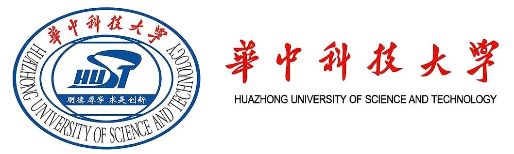
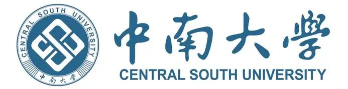



这是我的个人主页，在这里你可以看到我的相关信息，欢迎联系我！

我目前在华中科技大学实时与智能计算实验室攻读计算机科学与技术硕士，导师为李剑军教授。研究涉及信息抽取、大语言模型、检索增强生成（RAG）与智能体。

**教育经历**

	

        
2024.09-2027.06

        
华中科技大学 (985) 

        
计算机科学与技术

        
硕士

    

    

	

        
2020.09-2024.06

        
中南大学 (985) 

        
计算机科学与技术

        
本科

    

    

## 研究成果



### [{{ publication.title }}]({{ base_path }}{{ publication.url }})



{{ publication.excerpt }}



[查看全部学术成果]({{ base_path }}/publications/)

## 实习经历

- **腾讯 · TEG·AI 平台部 · 算法工程师（实习）**（2026.03–2026.09）：参与“元梦之星扣叮”的蒸馏训练与 RAG 流程搭建，以及 Vibe Gaming Agent 的 Search Agent 开发与训练。
- **小米 · 集团技术委·小爱算法 · 算法工程师（实习）**（2025.10–2025.12）：面向智能家居场景，开展多源 IoT 知识检索、RAG 框架开发及基于用户反馈的模型优化。

[查看详细实习经历]({{ base_path }}/cv/#internships)

## 荣誉与竞赛

- OPPO 企业奖学金、校级一等奖学金、校级三好学生、院级优秀学生干部。
- 本科期间获国家奖学金、校级奖学金、校级三好学生、院级优秀团员。
- 华为第十届 ICT 大赛中国全国三等奖：《基于 ModelEngine 的专业病理知识问答智能体开发》。
- 全国大学生计算机设计大赛国家级二等奖：《基于图谱融合的高性能精细化全景可视分析预警平台》。
- 阿里云天池电商知识图谱链接预测挑战赛正式赛：排名 23，参赛总数 20137。

[查看个人简历]({{ base_path }}/cv/)
