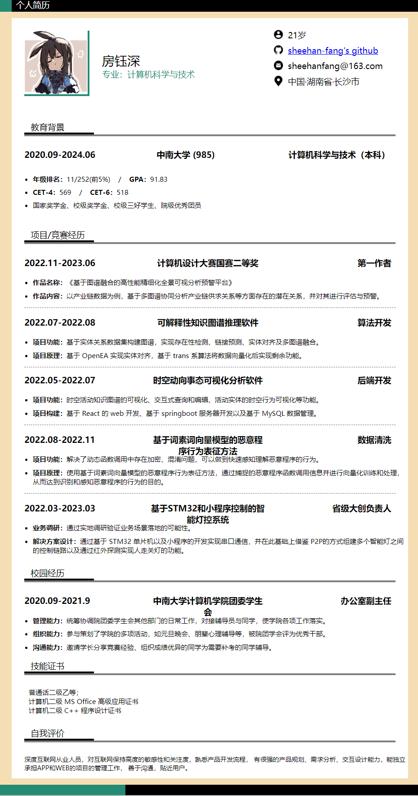


<!-- 可以点击这里查看网页版个人简历：[查看链接](../files/cv/cv.html)
图像预览版如下：
 -->
<html>

<head>
    <link href="{{ base_path }}/files/cv/style.css?v={{ site.time | date: '%Y%m%d%H%M%S' }}" rel="stylesheet" type="text/css" />
</head>

<body>
    

        

            
教育背景

        

        

            

                
2024.09-2027.06

                
华中科技大学 (985) 

                
计算机科学与技术（学硕）

            

            <ul class="dital_list">
                <li><b>GPA：</b>3.69</li>
                <li>实时与智能计算实验室（导师：李剑军教授）</li>
                <li>OPPO 企业奖学金、校级一等奖学金、校级三好学生、院级优秀学生干部</li>
            </ul>
        

        

        

            

                
2020.09-2024.06

                
中南大学 (985) 

                
计算机科学与技术（本科）

            

            <ul class="dital_list">
                <li><b>年级排名：</b>11/252&nbsp;&nbsp;/&nbsp;&nbsp;<b>GPA：</b>91.83</li>
                <li><b>CET-4：</b>569&nbsp;&nbsp;&nbsp;&nbsp;/&nbsp;&nbsp;&nbsp;&nbsp;<b>CET-6：</b>518</li>
                <li>国家奖学金、校级奖学金、校级三好学生、院级优秀团员</li>
            </ul>
        

        

            
学术经历

        

        
        
        

            
{{ publication.conference_year }}

            

                <a href="{{ base_path }}{{ publication.url }}" style="color: rgb(90, 90, 90);">{{ publication.title | escape }}</a>
            

            
{{ publication.author_role | escape }}

        

        <ul class="dital_list">
            <li><b>{{ publication.venue | escape }} {{ publication.conference_year }}（{{ publication.venue_note | escape }}） · 在投（尚未录用）已录用</b></li>
            <li><b>关键词：</b>{{ publication.keywords | join: '；' | escape }}</li>
            <li style="text-align: justify; padding-right: 40px;">
                <b>论文摘要：</b>
                
                
                    
                        {{ paragraph | strip_html }}
                    
                
            </li>
        </ul>
        

        
        

            
2024.06

            

                <a href="https://sheehan-fang.github.io/publication/2024-03-paper-1" style="color: rgb(90, 90, 90);">
                    基于自动稀释的文本对抗攻击强化方法
                </a>
            

            
第一作者

        

        <ul class="dital_list">
            <li><b>CCDM-2024会议录用</b></li>
            <li style="text-align: justify; padding-right: 40px;">
                <b>论文摘要：</b>
                使用对抗样本进行训练可以提升深度神经网络的鲁棒性，因此提升对抗攻击成功率是对抗样本研究领域的一个重要内容。
                对原始样本进行稀释操作可以使其更靠近模型的决策边界，进而提高对抗攻击的成功率。
                然而，现有稀释算法存在基于人工生成的稀释池和稀释目标词性单一等问题。
                因此，提出了一种基于自动稀释的文本对抗攻击强化方法，称为自动多词性稀释预处理（Automatic Multi-positional Dilution Preprocessing,AMDP）算法。
                AMDP算法使稀释过程摆脱了对人工辅助的依赖，针对不同数据集和目标模型生成不同的稀释池.同时，AMDP算法扩展了稀释目标的词性，扩大了稀释操作的搜索空间。
                作为一种输入转换方法，AMDP可以与其他对抗攻击算法相结合，进一步提高对抗攻击的性能。
                实验结果表明，AMDP在BERT,WordCNN和WordLSTM分类模型上的攻击成功率平均提升约10%，同时减少了对原始样本的平均修改率和对目标模型的平均访问次数。
            </li>
        </ul>
        

            
实习经历

        

        

            
2026.03–2026.09

            
深圳市腾讯计算机系统有限公司

            
算法工程师

        

        <ul class="dital_list">
            <li><b>实习部门：</b>TEG·AI 平台部</li>
            <li style="text-align: justify; padding-right: 40px;"><b>元梦之星扣叮：</b>负责蒸馏训练与 RAG 流程搭建。基于 SFT+OPD 蒸馏提升轻量模型的检索决策与工具调用能力，参与 Agent 工具调用链设计及 RAG 流程优化方案落地，在保证生成效果的同时提升复杂问题场景下的回答速度与检索效率。</li>
            <li style="text-align: justify; padding-right: 40px;"><b>Vibe Gaming Agent：</b>负责 Search Agent 开发与训练。基于 DeepResearch 挖掘用户潜在意图，通过多轮联网搜索与上下文补全生成游戏设计文档，基于 SFT+GRPO 提升需求分析效率、文档生成质量与用户交互体验。</li>
        </ul>
        

        

            
2025.10–2025.12

            
小米科技有限责任公司

            
算法工程师

        

        <ul class="dital_list">
            <li><b>实习部门：</b>集团技术委·小爱算法</li>
            <li style="text-align: justify; padding-right: 40px;"><b>实习内容：</b>设计并实现基于 RAG 的动态知识检索框架，整合多源 IoT 设备知识库，提升智能家居场景下复杂指令的语义理解与设备匹配准确率。</li>
            <li style="text-align: justify; padding-right: 40px;"><b>模型优化：</b>基于 DPO+用户反馈数据进行迭代训练，优化模型响应策略与设备召回能力，在降低响应延迟的同时提升 IoT 设备控制准确率与用户交互体验。</li>
        </ul>
        

            
项目经历

        

        

            
2022.11-2023.06

            
图谱融合可视分析预警平台（竞赛项目）

            
第一作者

        

        <ul class="dital_list">
            <li><b>作品名称：</b>《基于图谱融合的高性能精细化全景可视分析预警平台》</li>
            <li><b>作品内容：</b>以产业链数据为例，基于多图谱协同分析产业链供求关系等方面存在的潜在关系，并对其进行评估与预警。</li>
        </ul>
        

        

            
2022.07-2022.08

            

                <a href="https://sheehan-fang.github.io/publication/2022-08-software-1" style="color: rgb(90, 90, 90);">
                    可解释性知识图谱推理软件
                </a>
            

            
算法开发

        

        <ul class="dital_list">
            <li><b>项目功能：</b>基于实体关系数据集构建图谱，实现存在性检测、链接预测、实体对齐及多图谱融合。</li>
            <li><b>项目原理：</b>基于 OpenEA 实现实体对齐，基于 trans 系算法将数据向量化后实现剩余功能。</li>
        </ul>
        

        

            
2022.05-2022.07

            

                <a href="{{ base_path }}/publication/2022-07-software-2" style="color: rgb(90, 90, 90);">
                    时空动向事态可视化分析软件
                </a>
            

            
后端开发

        

        <ul class="dital_list">
            <li><b>项目功能：</b>时空活动知识图谱的可视化、交互式查询和编辑、活动实体的时空行为可视化等功能。</li>
            <li><b>项目构建：</b>基于 React 的 web 开发、基于 springboot 服务器开发以及基于 MySQL 数据管理。</li>
        </ul>
        

        

            
2022.08-2022.11

            

                <a href="https://sheehan-fang.github.io/publication/2022-11-patent-1" style="color: rgb(90, 90, 90);">
                    基于词素词向量模型的恶意程序行为表征方法
                </a>
            

            
数据清洗

        

        <ul class="dital_list">
            <li><b>项目功能：</b>解决了动态函数调用中存在加密、混淆问题，可以做到快速感知理解恶意程序的行为。</li>
            <li style="text-align: justify; padding-right: 40px;">
                <b>项目原理：</b>
                使用基于词素词向量模型的恶意程序行为表征方法，通过捕捉的恶意程序函数调用信息并进行向量化训练和处理，从而达到识别和感知恶意程序的行为的目的。
            </li>
        </ul>
        

        

            
2022.03-2023.03

            
基于STM32和小程序控制的智能灯控系统

            
省级大创负责人

        

        <ul class="dital_list">
            <li><b>业务调研：</b>通过实地调研验证业务场景落地的可能性。</li>
            <li style="text-align: justify; padding-right: 40px;">
                <b>解决方案设计：</b>
                通过基于 STM32 单片机以及小程序的开发实现串口通信，并在此基础上借鉴 P2P的方式组建多个智能灯之间的控制链路以及通过红外探测实现人走关灯的功能。
            </li>
        </ul>
        

            
竞赛获奖

        

        <ul class="dital_list">
            <li>华为第十届 ICT 大赛中国全国三等奖：《基于 ModelEngine 的专业病理知识问答智能体开发》。</li>
            <li>全国大学生计算机设计大赛国家级二等奖：<a href="#competition-project">《基于图谱融合的高性能精细化全景可视分析预警平台》</a>。</li>
            <li>阿里云天池电商知识图谱链接预测挑战赛正式赛：排名 23，参赛总数 20137。</li>
        </ul>
        

            
校园经历

        

        

            
2020.09-2021.9

            
中南大学计算机学院团委学生会

            
 办公室副主任

        

        <ul class="dital_list">
            <li><b>管理能力：</b>统筹协调院团委学生会其他部门的日常工作，对接辅导员与同学，使学院各项工作落实。</li>
            <li><b>组织能力：</b>参与策划了学院的多项活动，如元旦晚会、朋辈心理辅导等，被院团学会评为优秀干部。</li>
            <li><b>沟通能力：</b>邀请学长分享竞赛经验、组织成绩优异的同学为需要补考的同学辅导。</li>
        </ul>
        

            
技能证书

        

        <ul class="dital_list2">
            <li>普通话二级乙等；</li>
            <li>计算机二级 MS Office 高级应用证书</li>
            <li>计算机二级 C++ 程序设计证书</li>
        </ul>
        

            
自我评价

        

        

            深度互联网从业人员，对互联网保持高度的敏感性和关注度，熟悉产品开发流程，
            有很强的产品规划、需求分析、交互设计能力，能独立承担APP和WEB的项目的管理工作，
            善于沟通，贴近用户。
        

    

</body>
</html>